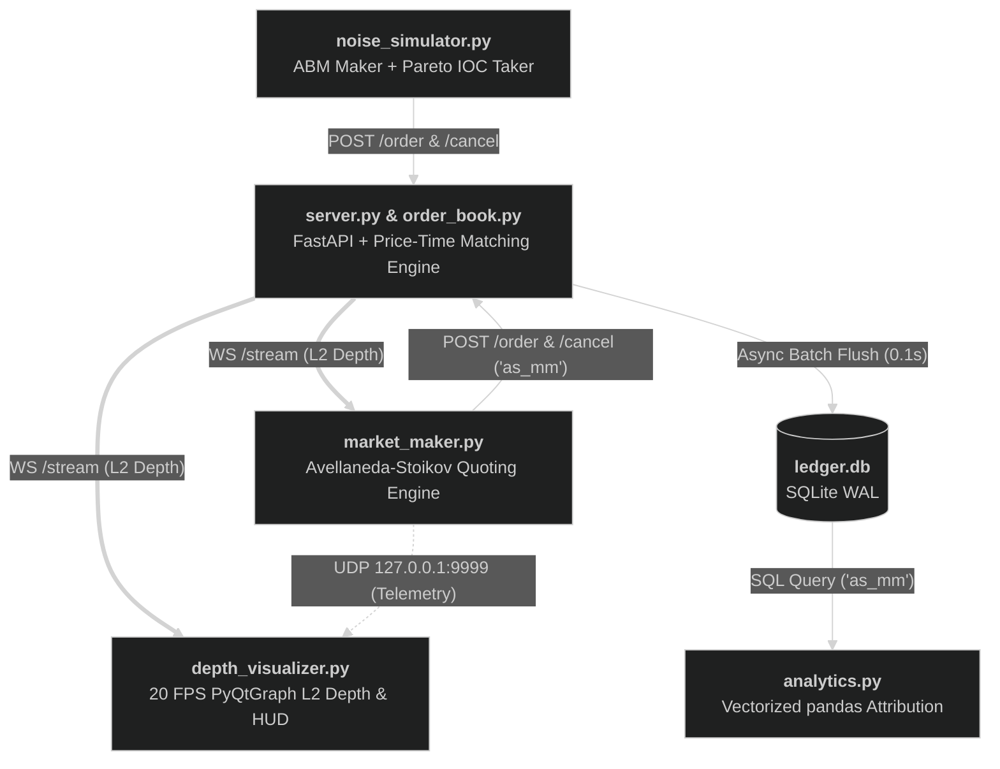

<div align="center">

# Avellaneda-Stoikov Market Making Suite

[](https://www.python.org/)
[](https://docs.aiohttp.org/)
[](https://www.pyqtgraph.org/)
[-FFD700?style=for-the-badge)](https://math.nyu.edu/~avellane/HighFrequencyTrading.pdf)

An institutional-style, asynchronous Market Making ecosystem implementing the **Avellaneda-Stoikov (2008)** stochastic optimal control framework (*"High-frequency trading in a limit order book"*).

Designed as a standalone quantitative client architecture connecting over WebSockets and REST to a custom [Limit Order Book](https://github.com/Romi071/limit-order-book) matching engine, complete with an exogenous stochastic order-flow simulator and a hardware-accelerated 20 FPS L2 depth & telemetry visualizer.

---

<!-- 
  TODO: Record a 5-8 second GIF of depth_visualizer.py running with the bot & simulator active, 
  save it as assets/live_hud_demo.gif (or drag-and-drop it into GitHub's web editor), and uncomment below:
-->
<!-- 
<p align="center">
  
  <br>
  <em>Real-time L2 cumulative order book depth, dynamic gold Reservation Price line, and 20 FPS Mark-to-Market PnL telemetry streamed over non-blocking localhost UDP.</em>
</p>
-->

</div>

## System Topology & Data Flow


---

## Core Components

### 1. `market_maker.py` — The Execution Hot Path (Completed)
Event-driven `asyncio` & `aiohttp` execution engine. Consumes live L2 WebSocket depth snapshots (`ws://localhost:8000/stream`), tracks real-time inventory ($q_t$), cash balance ($X_t$), and Mark-to-Market wealth ($W_t = X_t + q_t S_t$), and continuously quotes two-sided liquidity (`client_tag: 'as_mm'`) on a `0.5s` cadence around the stationary infinite-horizon ($\tau = \text{const}$) reservation price and optimal spread:

$$r(s, q, \tau) = s - q \gamma \sigma^2 \tau$$

$$\Delta(\tau) = \gamma \sigma^2 \tau + \frac{2}{\gamma} \ln\left(1 + \frac{\gamma}{\kappa}\right)$$

* **Lockstep `asyncio.Event` Coroutine Handshake:** Eliminates self-referential BBO skewing. Prior to firing `POST /cancel` requests, `quoting_loop` clears an `asyncio.Event` barrier and awaits `self.event.wait()` on `HTTP 200` responses, yielding execution until `socket_listener` ingests the server's post-cancel L2 broadcast so `mid_price` reflects strictly external liquidity.
* **Liquidity Vacuum Circuit Breaker:** Positioned strictly *after* resting orders are cancelled and cleared from the book, the bot evaluates `while not self.mid_price:` via zero-lag event-driven wakeups. If one side of the order book is wiped out during a flash crash, the bot parks itself with zero resting orders (flat execution risk) and resumes quoting the exact microsecond a two-sided market is restored.
* **Exact Maker/Taker Fill Accounting:** Evaluates semantic `HTTP 200` and `HTTP 404` cancellation responses to compute resting maker fills (`order_amount - cancelled_amount`) at quoted limit prices, while iterating over execution receipts (`fills`) on `POST /order` to capture price-improved taker fills across multiple price levels, guarded by symmetric inventory caps ($\pm q_{\max}$).
* **Fire-and-Forget UDP Telemetry Pipe:** Broadcasts real-time state payloads (`balance`, `inventory`, `res_price`, `wealth`) over a connectionless localhost UDP datagram socket (`127.0.0.1:9999`) with zero blocking I/O overhead on the critical quoting path.
* **Cancel-on-Disconnect Kill Switch:** Wraps the main `asyncio.gather` loop in a `try...finally` teardown block that invokes `cancel_all` upon process termination (`CancelledError` / `KeyboardInterrupt`), sweeping all remaining resting quotes from the exchange before closing the HTTP session.

### 2. `noise_simulator.py` — Exogenous Stochastic Order Flow (Completed)
Concurrent `asyncio` & `aiohttp` market simulator running two decoupled coroutines over a shared connection pool:
* **Latent Price & Passive Depth (`maker_loop`):** Evolves the unobservable fair price via discrete-time Arithmetic Brownian Motion ($S_{t+\Delta t} = S_t + \sigma \sqrt{\Delta t} Z$) and streams two-sided `GTC` limit orders (`client_tag: 'sim_maker'`) at uniform offsets $\delta \sim \mathcal{U}(0.02, 0.20)$ and volumes $\mathcal{U}(0.1, 5.0)$ quantized to a strict $0.01$ tick grid. Includes an $O(1)$ `collections.deque` FIFO garbage collector that actively sweeps stale resting quotes (`POST /cancel`) beyond $N_{\max}$ to prevent heap bloat and ghost-liquidity walls.
* **Aggressive Order Flow (`taker_loop`):** Models impatient market takers arriving via a Poisson process ($\Delta \tau \sim \text{Exp}(\lambda)$). Fires spread-crossing `IOC` orders (`client_tag: 'sim_taker'`) sized via a bounded power-law distribution ($\max(0.1, \min(25, 0.1 \cdot \text{Pareto}(\alpha = 1.5)))$ in the heavy-tailed Lévy regime) to simulate both retail noise and multi-level institutional liquidity sweeps.

### 3. `depth_visualizer.py` — Real-Time 20 FPS L2 & Telemetry GUI (Completed)
Hardware-accelerated desktop market depth and telemetry visualizer built with `PyQt6`, `pyqtgraph`, and `qasync`:
* **Unified `qasync` Event Loop:** Bridges Qt's C++ event loop with Python's `asyncio` loop on a single thread, streaming live L2 WebSocket updates without blocking GUI responsiveness.
* **Decoupled 20 FPS Rendering Pipeline (`50ms` `QTimer`):** Isolates high-frequency network ingestion (`self.latest_snapshot`) from OpenGL/Qt rendering, integrating cumulative bid and ask depth curves in real time via vectorized `numpy.cumsum` operations.
* **Non-Blocking UDP Telemetry & Live HUD:** Drains the localhost `SOCK_DGRAM` UDP buffer (`127.0.0.1:9999`) every `50ms` frame via non-blocking reads (`BlockingIOError`), re-valuing Mark-to-Market wealth at 20 FPS against live L2 best bid/ask mid-prices between bot quoting cycles. Renders a color-coded monospace HTML scoreboard (`PnL`, `Cash`, `Inv`, `Res Px`) in the plot title alongside a dynamic gold dashed `pg.InfiniteLine` tracking the bot's reservation price across the depth chart.

### 4. `analytics.py` — Cold-Path Attribution Pipeline (Planned)
Post-trade `pandas` & `matplotlib` attribution pipeline querying the exchange's SQLite WAL ledger (`ledger.db`). Isolates executions by `takerTag` / `makerTag` (`'as_mm'`), reconstructs inventory and equity trajectories, and decomposes Spread Capture vs. Inventory PnL.

---

## Model & Simulation Parameters

### 1. Avellaneda-Stoikov Market Maker (`market_maker.py`)

| Parameter | Symbol | Default Value | Description |
| :--- | :---: | :---: | :--- |
| Re-Quoting Cadence | $\Delta t_{\text{quote}}$ | `0.50s` | Cancel-and-replace cycle interval |
| Volatility Estimate | $\sigma$ | `0.50` | Assumed asset volatility per $\sqrt{\text{second}}$ |
| Risk Aversion | $\gamma$ | `1.0` | Inventory variance penalty parameter |
| Order Book Liquidity Density | $\kappa$ | `1.0` | Exponential fill-intensity decay constant |
| Stationary Time Horizon | $\tau$ | `1.0` | Infinite-horizon constant approximation ($\tau = T - t$) |
| Quote Lot Size | $q_{\text{order}}$ | `1.0` | Fixed per-side order volume (shares) |
| Max Inventory Limit | $q_{\max}$ | `±100` | Hard inventory risk bounds for gating bid/ask placement |
| Telemetry UDP Endpoint | — | `127.0.0.1:9999` | Non-blocking local `SOCK_DGRAM` telemetry target |

### 2. Exogenous Market Simulator (`noise_simulator.py`)

| Parameter | Symbol | Default Value | Description |
| :--- | :---: | :---: | :--- |
| Initial Fair Price | $S_0$ | `100.00` | Starting latent mid-price |
| ABM Volatility | $\sigma$ | `0.50` | Price diffusion scale per $\sqrt{\text{second}}$ |
| Maker Heartbeat | $\Delta t$ | `0.25s` | Passive quote injection & ABM step interval |
| Maker Quote Offset | $\delta_{\text{bid/ask}}$ | $\mathcal{U}(0.02, 0.20)$ | Random distance from latent fair price |
| Maker Lot Size | $V_{\text{maker}}$ | $\mathcal{U}(0.1, 5.0)$ | Random passive order volume (shares) |
| Max Active Maker Quotes | $N_{\max}$ | `50` | FIFO `deque` threshold for `POST /cancel` garbage collection |
| Taker Arrival Rate | $\lambda$ | `2.0` $\text{s}^{-1}$ | Exponential inter-arrival intensity for `IOC` takers |
| Taker Volume Tail Exponent | $\alpha$ | `1.5` | Capped Pareto shape parameter ($[0.1, 25.0]$ shares) |

---

## Running the Suite

Ensure the [Limit Order Book](https://github.com/Romi071/limit-order-book) exchange server (`uvicorn server:app --no-access-log`) is running on `http://localhost:8000`, then launch the ecosystem components in separate terminals:

```bash
# 1. Start the exogenous ABM maker & Pareto taker flow generator
python noise_simulator.py

# 2. Launch the real-time L2 cumulative depth & HUD visualizer
python depth_visualizer.py

# 3. Deploy the Avellaneda-Stoikov market maker
python market_maker.py
```

---

## Roadmap

- [x] Asynchronous ABM Maker & Poisson-Pareto Taker flow generator (`noise_simulator.py`)
- [x] Avellaneda-Stoikov quoting engine with `asyncio.Event` WebSocket synchronization & liquidity circuit breaker (`market_maker.py`)
- [x] Graceful cancel-on-disconnect kill switch to sweep resting quotes on shutdown (`market_maker.py`)
- [x] Real-time Mark-to-Market wealth ($W_t$) accounting and non-blocking UDP telemetry broadcast (`market_maker.py`)
- [x] Hardware-accelerated 20 FPS L2 cumulative depth visualizer (`depth_visualizer.py`)
- [x] Live HUD telemetry receiver (`127.0.0.1:9999`) overlay and dynamic reservation price line (`depth_visualizer.py`)
- [ ] Cold-path SQLite attribution and equity-curve analytics (`analytics.py`)
